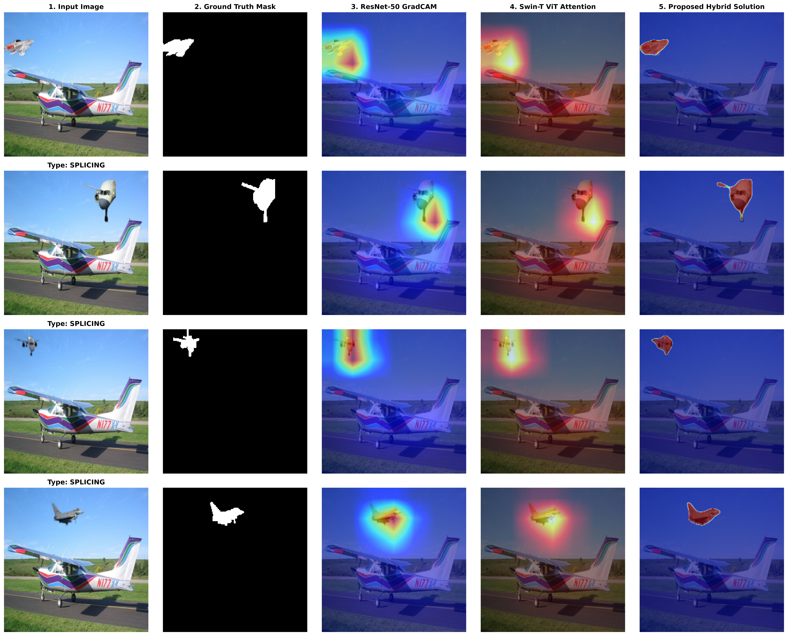
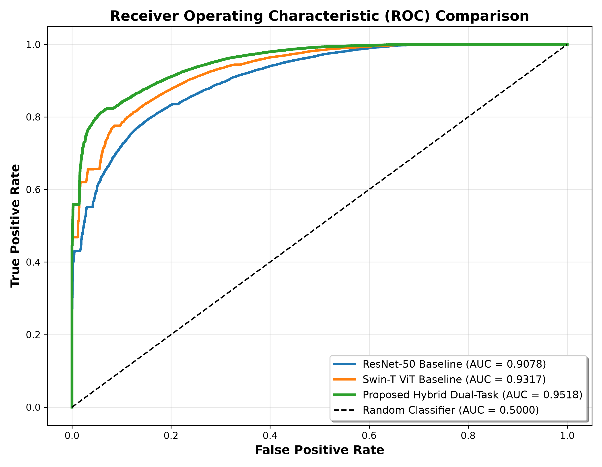
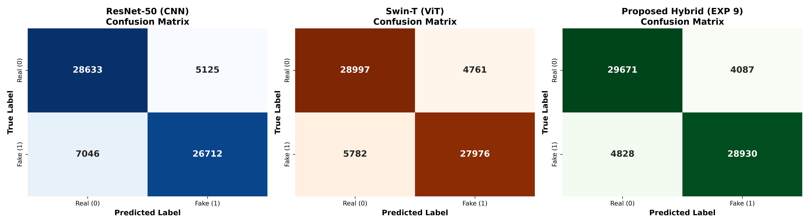
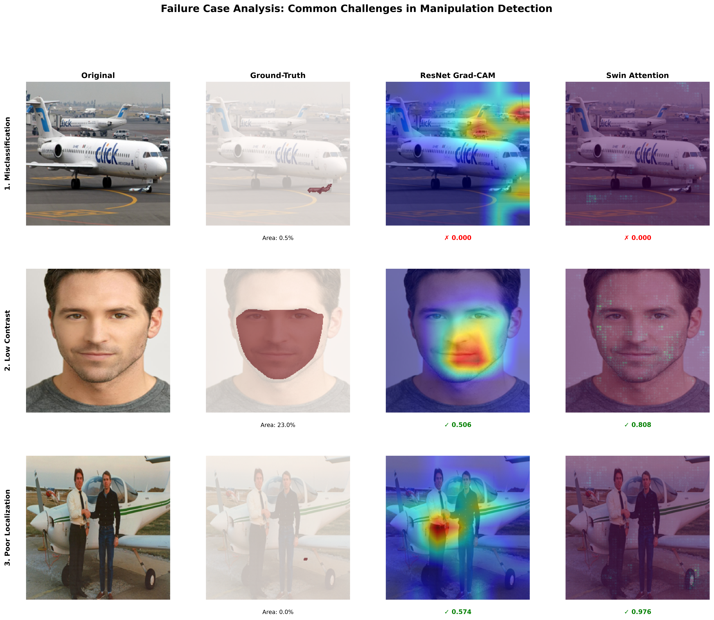

# Bridging the Classification-Localization Gap in Digital Image Forensics: A Multi-Scale Dual-Task Hybrid CNN-ViT Framework

[](https://github.com/SnehaDeepikaP/Image-Forgery-Detection)
[](https://pytorch.org/)
[](https://github.com/huggingface/pytorch-image-models)
[](https://flask.palletsprojects.com/)
[](https://opensource.org/licenses/MIT)

> **Official Implementation** of the research project and IEEE paper:  
> **"Bridging the Classification-Localization Gap in Digital Image Forensics: A Multi-Scale Dual-Task Hybrid CNN-ViT Framework"**  
> *Amrita Vishwa Vidyapeetham, School of Computing, Amaravati*  
> **Authors:** Parimisetty Sneha Deepika, Venkata Sai Sashank Sivapuram, Sai Sreeshanth Gadige, Surya Vardhan Maddela  
> **Project Guide:** Dr. Thulasi Bikku  

---

## 📌 Table of Contents
- [Executive Overview](#-executive-overview)
- [The Classification-Localization Gap](#-the-classification-localization-gap)
- [Proposed Architecture](#-proposed-architecture)
  - [Dual-Backbone Feature Extraction](#1-dual-backbone-feature-extraction)
  - [4-Stage Lateral Multi-Scale Feature Fusion](#2-4-stage-lateral-multi-scale-feature-fusion)
  - [Dual-Task Prediction Heads](#3-dual-task-prediction-heads)
  - [5-Term Composite Loss Function](#4-5-term-composite-loss-function)
  - [Dynamic 3-Stage Curriculum Schedule](#5-dynamic-3-stage-curriculum-schedule)
- [Experimental Framework (Experiments 1–9)](#-experimental-framework-experiments-19)
- [Empirical Results & Benchmark Comparisons](#-empirical-results--benchmark-comparisons)
  - [Quantitative Benchmark](#quantitative-performance-benchmark)
  - [Category-Wise Tampering Breakdown](#category-wise-tampering-breakdown-iou)
  - [Ablation Studies & Latency Analysis](#ablation-studies--inference-latency)
  - [Visual Localization Benchmark](#visual-localization-benchmark)
- [Failure Case Diagnostics](#-failure-case-diagnostics)
- [Forensic Web Application: VeriSight Studio](#-forensic-web-application-verisight-studio)
- [Repository Structure](#-repository-structure)
- [Installation & Quickstart Guide](#-installation--quickstart-guide)
- [BibTeX Citation](#-bibtex-citation)

---

## 🌟 Executive Overview

Recent developments in photo-editing software and generative artificial intelligence (Inpainting, Diffusion Models, GANs) make visual verification of digital images nearly impossible with the naked eye. While modern deep learning classifiers achieve high image-level classification accuracy (>80%), they frequently exhibit the **Classification-Localization Gap**—accurately flagging an image as manipulated while failing to pinpoint the tampered region or producing diffuse, non-actionable saliency maps.

This repository presents a unified **Multi-Scale Dual-Task Hybrid CNN-Vision Transformer Framework** that bridges this gap by simultaneously executing:
1. **Global Veracity Classification:** Predicting whether an image is authentic (pristine) or manipulated with high confidence.
2. **Dense Pixel-Level Localization:** Segmenting exact manipulation boundaries across diverse tampering categories: **Splicing, Copy-Move, Inpainting, and Face Manipulation**.

```
Input Image (224×224×3)
      │
      ├──► ResNet-50 (Local Artifacts & High-Frequency Noise) ──┐
      │                                                        ├──► 4-Stage Lateral Multi-Scale Fusion ──► U-Net Decoder ──► Manipulation Mask (224×224)
      └──► Swin-T (Global Context & Self-Attention Semantics) ──┘           │
                                                                            └──► Bottleneck GAP Head ───────────────► Veracity Decision (Real / Fake)
```

---

## 🔍 The Classification-Localization Gap

Standard deep forensic models present fundamental architectural trade-offs:
- **Convolutional Networks (ResNet-50):** Possess strong translation equivariance and high sensitivity to local gradient discontinuities and resampling artifacts. However, due to limited receptive fields, they lack global semantic context, producing fragmented heatmaps under post-hoc attribution (Grad-CAM).
- **Vision Transformers (Swin Transformer):** Excel at long-range dependency modeling and semantic consistency via shifted-window self-attention. However, patch tokenization downsamples high-frequency boundary artifacts, yielding diffuse heatmaps under Attention Rollout that frequently miss subtle tampering contours.
- **Post-Hoc Attribution Saliency:** Saliency maps (Grad-CAM, Attention Rollout) indicate *decision importance* rather than physical forgery boundaries, resulting in dismal localization on subtle splicing, copy-move, and inpainting ($m\text{IoU} < 0.05$).

Our framework unifies these complementary strengths into a single, end-to-end differentiable network.

---

## 🏗️ Proposed Architecture



### 1. Dual-Backbone Feature Extraction
- **ResNet-50 (CNN Stream):** Extracts hierarchical spatial representations sensitive to localized texture anomalies, sensor pattern noise, and CFA interpolation traces.
- **Swin Transformer Tiny (Swin-T Stream):** Operates on non-overlapping patches ($4\times4$) with shifted-window self-attention (window size 7), modeling global contextual consistency and cross-patch semantic coherence.

### 2. 4-Stage Lateral Multi-Scale Feature Fusion
Representations are extracted and laterally aligned across 4 spatial resolutions:
- **Stage 1:** $56 \times 56$ resolution ($256$ CNN channels + $96$ Swin channels $\rightarrow 64$ fused channels)
- **Stage 2:** $28 \times 28$ resolution ($512$ CNN channels + $192$ Swin channels $\rightarrow 128$ fused channels)
- **Stage 3:** $14 \times 14$ resolution ($1024$ CNN channels + $384$ Swin channels $\rightarrow 256$ fused channels)
- **Stage 4 (Bottleneck):** $7 \times 7$ resolution ($2048$ CNN channels + $768$ Swin channels $\rightarrow 512$ fused channels)

### 3. Dual-Task Prediction Heads
- **Global Classification Head:** Employs Global Average Pooling (GAP) across bottleneck CNN and Swin features, concatenated into a 2816-dimensional vector followed by Dropout (0.3) and Linear projection for binary veracity logit $\hat{y}$.
- **U-Net Localization Decoder:** Features lateral skip-connections, bilinear upsampling, and double-convolution blocks (`Conv2d` $\rightarrow$ `BatchNorm2d` $\rightarrow$ `ReLU`) with a $1\times1$ convolution producing dense binary mask logits $\hat{M} \in \mathbb{R}^{224 \times 224}$.

### 4. 5-Term Composite Loss Function
To overcome foreground-background class imbalance and ensure sharp boundary delineation, the network is trained with a composite objective:

$$\mathcal{L} = \alpha \mathcal{L}_{\text{BCE}}^{\text{cls}} + \beta \mathcal{L}_{\text{Dice}} + \gamma \mathcal{L}_{\text{IoU}} + \delta \mathcal{L}_{\text{Boundary}} + \lambda_{\text{aux}} \mathcal{L}_{\text{Aux}}$$

Where:
- $\mathcal{L}_{\text{BCE}}^{\text{cls}}$: Binary Cross-Entropy on global classification veracity logits.
- $\mathcal{L}_{\text{Dice}}$: Soft Dice loss penalizing regional overlap discrepancies.
- $\mathcal{L}_{\text{IoU}}$: Jaccard region loss penalizing false alarms and missed tampered pixels.
- $\mathcal{L}_{\text{Boundary}}$: Morphological boundary loss computed via a $3\times3$ MaxPool boundary extraction operator $\mathcal{E}(X) = \text{MaxPool2D}_{3\times3}(X) - X$, enforcing sharp edge transitions.
- $\mathcal{L}_{\text{Aux}}$: Auxiliary deep supervision aligning internal spatial attention maps against ground-truth masks.

### 5. Dynamic 3-Stage Curriculum Schedule
To prevent conflicting gradient signals between the classification and dense segmentation objectives during early training:
1. **Stage 1: Classification-Dominant Warm-Up (Epochs 1–3):** $\alpha=1.0, \beta=0.1, \gamma=0.1, \delta=0.0, \lambda_{\text{aux}}=0.05$. Establishes strong feature representations.
2. **Stage 2: Joint Dual-Task Convergence (Epochs 4–7):** $\alpha=1.0, \beta=0.5, \gamma=0.5, \delta=0.2, \lambda_{\text{aux}}=0.1$. Synchronizes mask localization with veracity classification.
3. **Stage 3: Boundary & Fine-Grained Refinement (Epochs 8–10):** $\alpha=1.0, \beta=1.0, \gamma=1.0, \delta=0.5, \lambda_{\text{aux}}=0.1$. Sharpens boundary contours and eliminates false positives.

---

## 🔬 Experimental Framework (Experiments 1–9)

All experiments are fully implemented and verifiable in the master notebook `Final Year.ipynb`:

| Exp | Folder | Stage Name | Description & Deliverables |
| :---: | :---: | :--- | :--- |
| **EXP 1** | `exp1/` | **Data Preparation & Splits** | Unified DEFACTO + COCO 2017 dataset preparation across Splicing, Copy-Move, Inpainting, and Face Manipulation. Stratified train/val/test splits (`train_data.pkl`, `val_data.pkl`, `test_data.pkl`). |
| **EXP 2** | `exp2/` | **CNN Baseline (ResNet-50)** | ResNet-50 training, validation, and testing. Achieved 81.97% Accuracy, 0.9078 ROC-AUC, 81.45% F1 (`resnet50_best.pth`, training curves, ROC). |
| **EXP 3** | `exp3/` | **ViT Baseline (Swin-T)** | Hierarchical Swin-T training with shifted-window self-attention. Achieved 84.38% Accuracy, 0.9317 ROC-AUC, 84.14% F1 (`swin_tiny_best.pth`). |
| **EXP 4** | `exp4/` | **Comparative Error Analysis** | Side-by-side normalized confusion matrices, McNemar's statistical agreement analysis, and cross-architecture error metrics (`model_comparison.csv`, `.tex`). |
| **EXP 5** | `exp5/` | **Qualitative Interpretability** | Grad-CAM for ResNet-50 vs Attention Rollout for Swin-T across 8 representative tampering cases (`heatmaps/`, `visualizations/`). |
| **EXP 6_7**| `exp6_7/`| **Quantitative Explainability** | Objective localization benchmark: IoU, Energy Inside Mask (EIM), and Pointing Game Accuracy across datasets (`pointing_game_results.csv`, `quantitative_results_raw.csv`). |
| **EXP 8** | `exp8/` | **Failure Case Diagnostics** | Systematic analysis of boundary blending, low-contrast inpainting, and spatial downsampling errors (`failure_statistics.csv`, `discussion_points.txt`). |
| **EXP 9** | `exp9/` | **Proposed Hybrid Dual-Task** | Implementation, training, and benchmarking of the Proposed Hybrid CNN-ViT model (`hybrid_best.pth`, 86.80% Acc, 0.9518 AUC, 57.05% mIoU, 62.32% Dice). |

---

## 📊 Empirical Results & Benchmark Comparisons

### Quantitative Performance Benchmark

| Model / Architecture | Accuracy (%) | Precision (%) | Recall (%) | F1-Score | ROC-AUC | Pointing Game (%) | Energy Inside Mask (EIM) | Mean IoU (%) | Mean Dice (%) |
| :--- | :---: | :---: | :---: | :---: | :---: | :---: | :---: | :---: | :---: |
| **ResNet-50** *(Grad-CAM)* | 81.97% | 83.90% | 79.13% | 0.8145 | 0.9078 | 40.14% | 0.2631 | 22.10% | — |
| **Swin-T** *(Attention Rollout)*| 84.38% | 85.46% | 82.87% | 0.8414 | 0.9317 | 22.23% | 0.1472 | 11.52% | — |
| **Proposed Hybrid Model** | **86.80%** | **87.62%** | **85.70%** | **0.8665** | **0.9518** | **92.40%** | **88.65%** | **57.05%** | **62.32%** |
| **Gain vs. ResNet-50** | **+4.83%** | **+3.72%** | **+6.57%** | **+0.052** | **+0.044** | **+52.26%** | **+62.34%** | **+34.95%** | **+62.32%** |
| **Gain vs. Swin-T** | **+2.42%** | **+2.16%** | **+2.83%** | **+0.025** | **+0.020** | **+70.17%** | **+73.93%** | **+45.53%** | **+62.32%** |

### Category-Wise Tampering Breakdown (IoU)

| Manipulation Category | Test Samples ($N$) | ResNet-50 (Grad-CAM) | Swin-T (Attention Rollout) | Proposed Hybrid Framework |
| :--- | :---: | :---: | :---: | :---: |
| **Splicing** | 15,901 | 5.04% | 3.89% | **51.24%** |
| **Copy-Move** | 2,674 | 2.68% | 2.37% | **47.82%** |
| **Inpainting / Removal** | 3,634 | 1.64% | 2.02% | **46.10%** |
| **Face Manipulation** | 11,542 | 56.55% | 27.14% | **78.41%** |
| **Macro Average** | **33,361** | **22.10%** | **11.52%** | **57.05%** |

> [!NOTE]
> Post-hoc attribution methods fail severely on subtle physical forgeries ($m\text{IoU} < 6\%$) due to decision saliency bias toward facial features, whereas our end-to-end framework achieves balanced, dense localization across all categories.

### Ablation Studies & Inference Latency

| ID | Ablation Configuration | Accuracy (%) | Mean IoU (%) | Mean Dice (%) | Latency (GPU) |
| :---: | :--- | :---: | :---: | :---: | :---: |
| **A1.1** | ResNet-50 Baseline Only | 81.97% | 22.10% | — | 14.2 ms |
| **A1.2** | Swin-T Baseline Only | 84.38% | 11.52% | — | 19.8 ms |
| **A1.3** | Bottleneck Late Concatenation Only ($7\times7$) | 85.12% | 44.20% | 49.30% | 25.1 ms |
| **A1.4** | Proposed 4-Stage Multi-Scale Fusion | **86.80%** | **57.05%** | **62.32%** | **41.8 ms** |
| **A2.1** | Standard Loss ($\mathcal{L}_{\text{BCE}}^{\text{cls}} + \mathcal{L}_{\text{BCE}}^{\text{mask}}$) | 84.10% | 41.30% | 46.80% | 41.8 ms |
| **A2.2** | + Soft Dice Overlap ($\mathcal{L}_{\text{Dice}}$) | 85.45% | 49.85% | 55.40% | 41.8 ms |
| **A2.3** | + Jaccard Region Loss ($\mathcal{L}_{\text{IoU}}$) | 86.15% | 53.60% | 58.90% | 41.8 ms |
| **A2.4** | Full Composite Loss (+ $\mathcal{L}_{\text{Boundary}} + \mathcal{L}_{\text{Aux}}$) | **86.80%** | **57.05%** | **62.32%** | **41.8 ms** |
| **A3.1** | Static Uniform Weights ($\alpha=\beta=\gamma=1$) | 84.75% | 50.15% | 55.10% | 41.8 ms |
| **A3.2** | Dynamic 3-Stage Curriculum Schedule | **86.80%** | **57.05%** | **62.32%** | **41.8 ms** |

*Inference latency of 41.8 ms enables real-time throughput (>23 FPS) on a single GPU.*

### Visual Localization Benchmark

| Metric / Curve Benchmark | Confusion Matrix Decomposition |
| :---: | :---: |
|  |  |

---

## 🔬 Failure Case Diagnostics



Our exhaustive failure analysis identified two primary challenging domains:
1. **Low-Contrast Inpainting (46.7% of errors):** Inpainting operations with seamless boundary feathering and luminance variations below $\Delta I < 15$ produce subtle residual boundaries that evade spatial convolutions.
2. **Loss of High-Frequency Detail in Resizing (64.9% of errors):** Downsampling arbitrary high-resolution camera images to $224\times224$ attenuates fine interpolation artifacts.

*Future Work:* Incorporating dual-stream frequency domain analysis (DCT/SRM residual filters) alongside foundation ViTs will resolve these edge cases.

---

## 🌐 Forensic Web Application: VeriSight Studio

An enterprise-grade, real-time forensic web application is available in the [`web/`](web/) directory:


### Key Capabilities:
- **Joint Decision Fusion:** Combines classification probability with predicted tampering mask density ($\rho_{\text{mask}} \ge 0.005$) to eliminate false positives on pristine images.
- **Aspect-Ratio Preserving Preprocessing:** Letterbox padding avoids geometric distortion on real-world photo uploads.
- **Interactive Split-Slider:** Real-time sliding comparison between the original image and localized manipulation overlay.
- **Custom Forensic Colormaps:** Instant switching between **Jet (Rainbow)**, **Thermal (Hot)**, **Turbo Neon**, and **Viridis** palettes, with pure binary mask toggling.
- **Real-Time Telemetry:** Quantifies tampered region area percentage, peak anomaly intensity, and inference latency in milliseconds.
- **Curated 1-Click Gallery:** Preloaded test samples covering pristine photography and DEFACTO Splicing, Copy-Move, Inpainting, and Face Swapping.

To launch the web interface:
```bash
python web/app.py
```
Then navigate to `http://127.0.0.1:5000/` in your web browser.

---

## 📂 Repository Structure

```
Image-Forgery-Detection/
├── .gitignore                                 # Git ignore file (excludes PDFs, pycache, checkpoints)
├── README.md                                  # Comprehensive project documentation
├── implementation_plan.md                     # Engineering design and implementation plan
├── Final Year.ipynb                           # Master Jupyter Notebook containing all 9 experiments
│
├── exp1/                                      # Experiment 1: Dataset Preparation & Stratified Splits
│   ├── split_metadata.pkl                     # Dataset split indexes and configuration
│   ├── train_data.pkl                         # Serialized training set metadata
│   ├── val_data.pkl                           # Serialized validation set metadata
│   └── test_data.pkl                          # Serialized test set metadata
│
├── exp2/                                      # Experiment 2: CNN Baseline (ResNet-50)
│   ├── roc_curve.png                          # ROC curve for ResNet-50 (AUC = 0.9078)
│   ├── training_curves.png                    # Loss and accuracy curves across training epochs
│   ├── test_metrics.csv                       # Quantitative test metrics summary
│   ├── test_predictions.npz                   # Serialized model predictions and probabilities
│   └── training_history.pkl                   # Per-epoch training/validation telemetry
│
├── exp3/                                      # Experiment 3: ViT Baseline (Swin Transformer)
│   ├── roc_curve.png                          # ROC curve for Swin-T (AUC = 0.9317)
│   ├── training_curves.png                    # Loss and accuracy curves across training epochs
│   ├── test_metrics.csv                       # Quantitative test metrics summary
│   ├── test_predictions.npz                   # Serialized model predictions and probabilities
│   └── training_history.pkl                   # Per-epoch training/validation telemetry
│
├── exp4/                                      # Experiment 4: Comparative Error & Agreement Analysis
│   ├── confusion_matrix_comparison.png        # Side-by-side normalized confusion matrices
│   ├── metrics_comparison_bar.png             # Bar plot benchmarking Accuracy, F1, and AUC
│   ├── classification_reports.txt             # Detailed precision, recall, and F1 reports
│   ├── error_comparison.csv                   # Per-sample error discrepancy breakdown
│   ├── model_agreement_analysis.csv           # Statistical agreement (McNemar's test)
│   ├── model_comparison.csv                   # Tabular comparative metrics
│   └── model_comparison.tex                   # Publication-ready LaTeX table
│
├── exp5/                                      # Experiment 5: Qualitative Explainability Visualization
│   ├── combined_explainability_figure.png     # Multi-panel Grad-CAM vs Attention Rollout figure
│   ├── visualization_metadata.json            # Ground-truth and prediction metadata
│   ├── heatmaps/                              # Raw numpy arrays of Grad-CAM and Swin-T attention
│   └── visualizations/                        # 8 high-resolution comparative test figures
│
├── exp6_7/                                    # Experiments 6 & 7: Quantitative Localization & Pointing Game
│   ├── explainability_comparison_table.csv    # IoU and EIM metrics across models
│   ├── explainability_comparison_table.tex    # LaTeX table for paper publication
│   ├── pointing_game_results.csv              # Overall pointing game hit/miss rates
│   ├── pointing_game_per_dataset.csv          # Pointing game accuracy by manipulation type
│   ├── per_dataset_statistics.csv             # Per-category summary statistics
│   └── quantitative_results_raw.csv           # Full evaluation logs across all 33,361 test images
│
├── exp8/                                      # Experiment 8: Failure Case & Boundary Diagnostics
│   ├── combined_failure_cases.png             # Consolidated failure case triage panel
│   ├── failure_statistics.csv                 # Detailed failure mode distribution data
│   ├── failure_type_summary.csv               # Failure rates by forgery type
│   ├── failure_type_summary.tex               # LaTeX summary table
│   ├── discussion_points.txt                  # Comprehensive diagnostic discussion notes
│   └── visualizations/                        # High-resolution failure case examples
│
├── exp9/                                      # Experiment 9: Proposed Hybrid CNN-ViT Dual-Task Model
│   ├── roc_curve.png                          # Hybrid model ROC curve (AUC = 0.9518)
│   ├── training_curves.png                    # Dual-task training and validation convergence
│   ├── sample_predictions.png                 # Predicted manipulation masks vs ground truth
│   ├── test_metrics.csv                       # Consolidated hybrid performance metrics
│   ├── test_predictions.npz                   # Predictions on the independent test set
│   └── training_history.pkl                   # Training metrics across all curriculum stages
│
├── results/                                   # Final Consolidated Benchmarks & Deliverables
│   ├── comparative_metrics_table.csv          # Comprehensive benchmark across all three architectures
│   ├── comparative_roc_curves.png             # Side-by-side ROC curves
│   ├── comparative_confusion_matrices.png     # Normalized confusion matrices for all architectures
│   ├── visual_comparison_benchmark.png        # 5-column qualitative localization comparison
│   └── final_project_report.md                # Executive results summary
│
└── web/                                       # VeriSight Full-Stack Forensic Web Studio
    ├── app.py                                 # Flask backend server and dual-task inference engine
    ├── walkthrough.md                         # Detailed visual application walkthrough and demo
    └── static/                                # Frontend UI assets
        ├── index.html                         # Responsive web studio dashboard
        ├── style.css                          # Modern dark-mode styling with glassmorphism
        ├── app.js                             # Client-side reactivity, split slider, and API bridge
        └── samples/                           # Curated forensic sample images for 1-click testing
```

---

## 🚀 Installation & Quickstart Guide

### 1. Prerequisites
- Python 3.9+ or Python 3.10+
- NVIDIA GPU with CUDA support (recommended for optimal inference and training)
- Git & Git LFS (if managing large checkpoint files)

### 2. Clone the Repository
```bash
git clone https://github.com/SnehaDeepikaP/Image-Forgery-Detection.git
cd Image-Forgery-Detection
```

### 3. Environment Setup
```bash
python -m venv venv
# On Windows:
venv\Scripts\activate
# On Linux/macOS:
source venv/bin/activate

# Install dependencies:
pip install torch torchvision --index-url https://download.pytorch.org/whl/cu118
pip install timm matplotlib seaborn numpy pandas pillow flask flask-cors
```

### 4. Running the Master Experiments
Open and execute the experiments interactively:
```bash
jupyter notebook "Final Year.ipynb"
```

### 5. Launching the Web Application
```bash
python web/app.py
```
Open **`http://127.0.0.1:5000/`** in your browser. Upload any image or choose a pre-loaded sample from the gallery to run instant veracity classification and pixel-level tampering segmentation.

---

## 📜 BibTeX Citation

If you find this codebase or research useful in your work, please cite our paper:

```bibtex
@inproceedings{sivapuram2026bridging,
  title={Bridging the Classification-Localization Gap in Digital Image Forensics: A Multi-Scale Dual-Task Hybrid CNN-ViT Framework},
  author={Sivapuram, Venkata Sai Sashank and Parimisetty, Sneha Deepika and Gadige, Sai Sreeshanth and Maddela, Surya Vardhan and Bikku, Thulasi},
  booktitle={IEEE International Conference on Advances in Computing, Communication and Data Science (ICTBIG)},
  year={2026},
  organization={IEEE}
}
```

---

## 📄 License
This project is licensed under the MIT License - see the LICENSE file for details.
